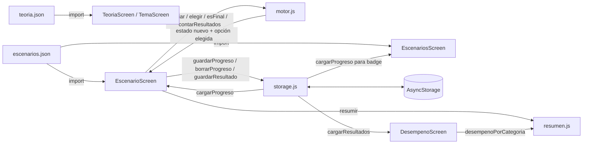
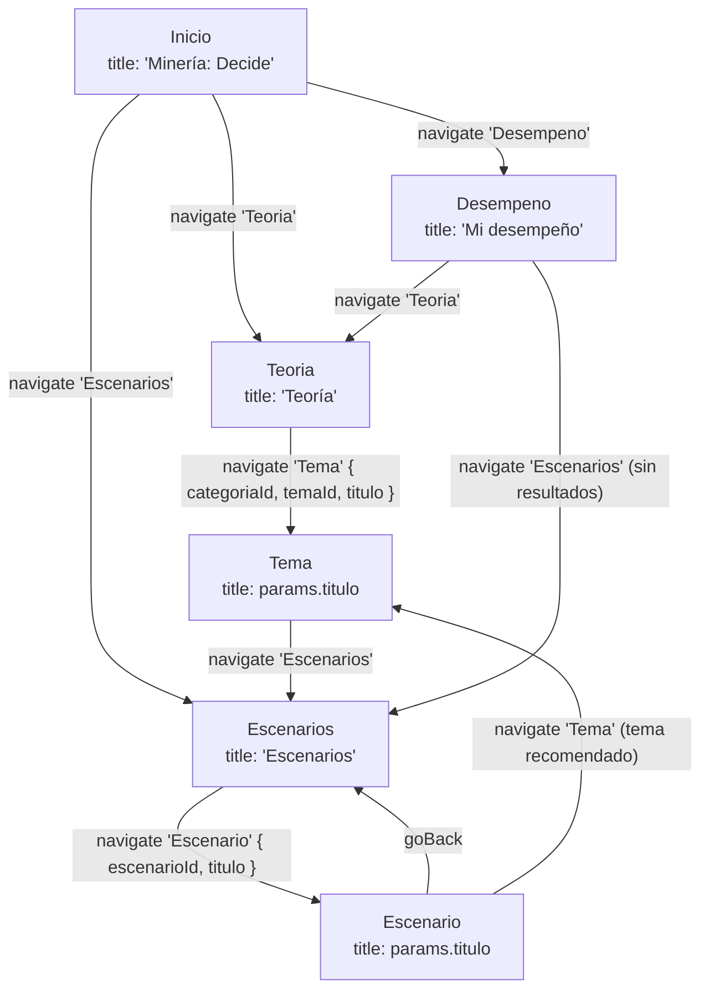

# 01 — Arquitectura

## Capas

| Capa | Archivos | Responsabilidad | Depende de |
| --- | --- | --- | --- |
| Datos | [teoria.json](../../app/src/data/teoria.json), [escenarios.json](../../app/src/data/escenarios.json) | Contenido de capacitación, embebido en el bundle (RF01). | — |
| Lógica pura | [motor.js](../../app/src/logic/motor.js), [resumen.js](../../app/src/logic/resumen.js) | Avanzar un escenario, saber si terminó, contar aciertos, validar el grafo; resumen de una partida y desempeño por categoría. Sin React ni AsyncStorage. | `resumen.js` usa `motor.js` |
| Almacenamiento | [storage.js](../../app/src/storage.js) | Única puerta a AsyncStorage: progreso y resultados. | `@react-native-async-storage/async-storage` |
| Pantallas | [src/screens/](../../app/src/screens/) | Leer datos, llamar al motor y al storage, pintar. | todas las anteriores |
| Componentes | [BotonGrande.js](../../app/src/components/BotonGrande.js), [Fila.js](../../app/src/components/Fila.js), [Grupo.js](../../app/src/components/Grupo.js), [PanelFeedback.js](../../app/src/components/PanelFeedback.js), [ResumenEscenario.js](../../app/src/components/ResumenEscenario.js), [theme.js](../../app/src/theme.js) | Piezas visuales reutilizables y tokens de estilo (detalle en [07-diseno-ui.md](07-diseno-ui.md)). | `theme.js`, `@expo/vector-icons` |

Regla: las flechas solo van hacia abajo. `motor.js` no importa nada; `storage.js` no conoce las pantallas. Si necesitas lógica nueva, ponla (como se hizo con [resumen.js](../../app/src/logic/resumen.js)) como función pura en `src/logic/` y pruébala con node (ver [06-pruebas.md](06-pruebas.md)).

### Por qué así

- **Offline-first (RNF02).** En interior mina no hay señal. Todo el contenido va dentro de la app y el estado se guarda en el teléfono. No hay ninguna llamada de red.
- **Sin backend en el MVP.** RF06/RF08/RF09 (sincronización, login, panel de supervisores) son *Won't*. Un backend añadiría infraestructura sin aportar a los criterios de aceptación HU01-HU06.
- **Lógica pura testeable con node.** `motor.js` recibe datos y devuelve datos nuevos, sin efectos. Por eso se prueba con `node --test` sin emulador, sin Jest y sin dependencias extra (RNF07 mantenibilidad).

## Flujo de datos

El estado de una partida es un objeto plano `{ escenarioId, nodoId, decisiones: [...] }` creado por [`iniciar`](../../app/src/logic/motor.js#L1-L3). Ese mismo objeto es el que se persiste tal cual; no hay conversión entre "estado de UI" y "estado guardado". Detalle del motor en [03-motor-escenarios.md](03-motor-escenarios.md); detalle de persistencia en [04-almacenamiento.md](04-almacenamiento.md).

## Navegación

Un único native-stack declarado en [App.js:24-40](../../app/App.js#L24-L40). Los estilos comunes del header (fondo gris `fondo` sin sombra, flecha y botones en `primario`, botón atrás "Atrás") se definen una sola vez en `screenOptions` ([App.js:25-32](../../app/App.js#L25-L32)). Las pantallas de lista (`Inicio`, `Teoria`, `Escenarios`, `Desempeno`) usan además `tituloGrande` ([App.js:14-18](../../app/App.js#L14-L18)): el título grande nativo de iOS que se encoge al hacer scroll. Es nativo (`react-native-screens`), así que no cuesta rendimiento; en Android se ve como header normal.

| Ruta | Pantalla | Params | Dónde se navega |
| --- | --- | --- | --- |
| `Inicio` | [InicioScreen](../../app/src/screens/InicioScreen.js) | — | ruta inicial (primera del Stack, [App.js:34](../../app/App.js#L34)) |
| `Teoria` | [TeoriaScreen](../../app/src/screens/TeoriaScreen.js) | — | [InicioScreen.js:17](../../app/src/screens/InicioScreen.js#L17) |
| `Tema` | [TemaScreen](../../app/src/screens/TemaScreen.js) | `categoriaId`, `temaId`, `titulo` | [TeoriaScreen.js:18](../../app/src/screens/TeoriaScreen.js#L18), resumen de escenario [EscenarioScreen.js:61](../../app/src/screens/EscenarioScreen.js#L61) |
| `Escenarios` | [EscenariosScreen](../../app/src/screens/EscenariosScreen.js) | — | [InicioScreen.js:25](../../app/src/screens/InicioScreen.js#L25), [TemaScreen.js:38](../../app/src/screens/TemaScreen.js#L38) |
| `Escenario` | [EscenarioScreen](../../app/src/screens/EscenarioScreen.js) | `escenarioId`, `titulo` | [EscenariosScreen.js:35](../../app/src/screens/EscenariosScreen.js#L35) |
| `Desempeno` | [DesempenoScreen](../../app/src/screens/DesempenoScreen.js) | — | [InicioScreen.js:35](../../app/src/screens/InicioScreen.js#L35) |

Se pasan **ids**, no objetos: cada pantalla busca el dato en el JSON con el id ([TemaScreen.js:9-10](../../app/src/screens/TemaScreen.js#L9-L10), [EscenarioScreen.js:13](../../app/src/screens/EscenarioScreen.js#L13)). `titulo` va en los params solo para que el header lo muestre ([App.js:36](../../app/App.js#L36), [App.js:38](../../app/App.js#L38)) sin volver a buscar.

Para agregar una pantalla: crear el archivo en `src/screens/`, importarlo en `App.js` y añadir un `<Stack.Screen>`.

## Diseño visual

El sistema de diseño (colores estilo iOS, iconos Ionicons en lugar de emojis, componentes `Fila`, `Grupo`, `BotonGrande`, `PanelFeedback`) y las reglas de rendimiento están en [07-diseno-ui.md](07-diseno-ui.md).
