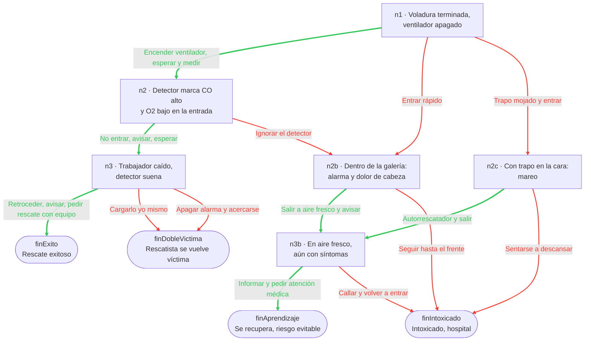
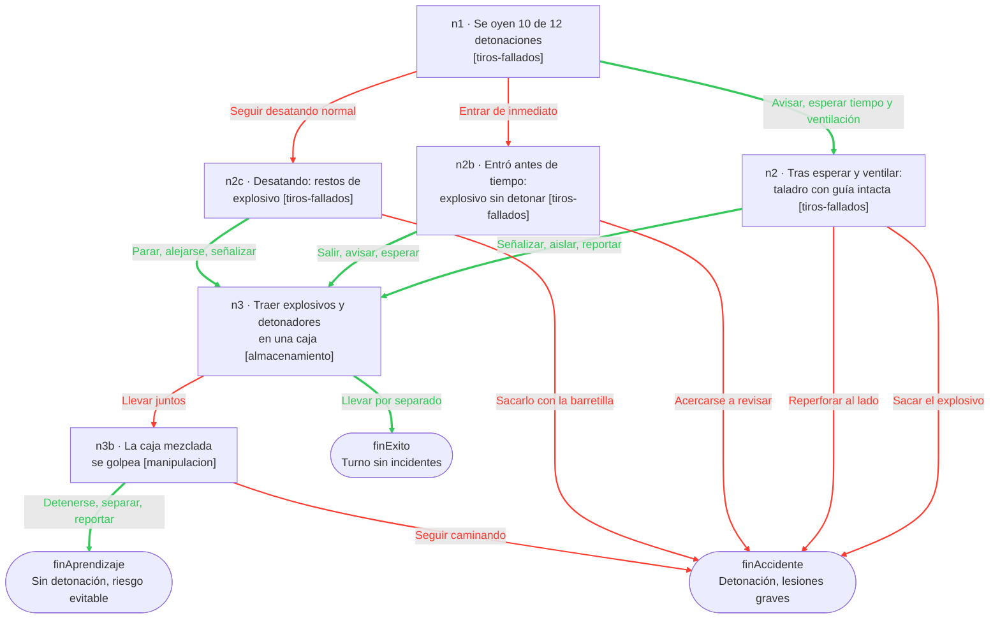

# 03 · Motor de escenarios (RF03 / RF04 · HU02 / HU03)

> **HU02:** completar un escenario de **mínimo 3 decisiones encadenadas**, cada una lleva a una rama distinta.
> **HU03:** tras cada decisión se muestra si fue correcta o incorrecta **y la razón**, antes de continuar.

| Archivo | Rol |
|---|---|
| [escenarios.json](../../app/src/data/escenarios.json) | Contenido: grafo de nodos y opciones |
| [motor.js](../../app/src/logic/motor.js) | Lógica pura (sin React, sin almacenamiento) |
| [motor.test.mjs](../../app/src/logic/motor.test.mjs) | Pruebas con `node:test` (ver [06-pruebas.md](06-pruebas.md)) |

Las pantallas que usan el motor se explican en [05-pantallas-escenarios.md](05-pantallas-escenarios.md); la persistencia del estado, en [04-almacenamiento.md](04-almacenamiento.md).

---

## 1. Modelo: un escenario es un grafo

Cada escenario es un **grafo dirigido**: los nodos son situaciones y las opciones son aristas hacia el siguiente nodo. Una decisión incorrecta no termina el escenario de inmediato: lleva a una rama de consecuencias donde el usuario aún puede reaccionar bien (recuperarse) o empeorar. Esto modela mejor la realidad que un cuestionario lineal.

El contenido vive en JSON (importado en el bundle, funciona offline igual que la teoría — ver [02-modulo-teorico.md](02-modulo-teorico.md#1-por-qué-funciona-sin-conexión)) y el motor es genérico: **un escenario nuevo no requiere código nuevo**.

## 2. Esquema de `escenarios.json`

Arreglo de escenarios.

### Escenario

| Campo | Tipo | Descripción |
|---|---|---|
| `id` | string | Único. Se usa en navegación y como parte de la clave de almacenamiento (`@mineria/progreso/<id>`). No cambiarlo una vez publicado: se perdería el progreso guardado. |
| `titulo` | string | Fila en la lista y header de la pantalla |
| `categoriaId` | string | Debe ser un `id` de categoría de [teoria.json](../../app/src/data/teoria.json) (`ventilacion`, `explosivos`). Se guarda en cada resultado para HU05. |
| `descripcion` | string | Texto de la tarjeta en la lista |
| `inicio` | string | Id del primer nodo |
| `nodos` | objeto `{ [id]: nodo }` | Diccionario de nodos. Se usa objeto (no arreglo) para buscar por id en O(1): `nodos[id]`. |

### Nodo de decisión

| Campo | Tipo | Descripción |
|---|---|---|
| `situacion` | string | Lo que vive el trabajador en ese momento |
| `tema` | string (opcional) | `id` de un tema de `teoria.json` dentro de la categoría del escenario. Si el usuario se equivoca en este nodo, el resumen le recomienda ese tema ([08-resumen-desempeno.md](08-resumen-desempeno.md)). |
| `opciones` | opcion[] | 2 o 3 opciones recomendado |

### Nodo final

| Campo | Tipo | Descripción |
|---|---|---|
| `situacion` | string | Desenlace (consecuencia de la cadena de decisiones) |
| `final` | `true` | Marca de fin. No lleva `opciones`. |

### Opción

| Campo | Tipo | Descripción |
|---|---|---|
| `texto` | string | Texto del botón |
| `correcta` | boolean | Si la decisión es la segura **en ese nodo** |
| `feedback` | string | Explicación mostrada en `PanelFeedback` (HU03). Empezar con "Correcto." o "Incorrecto." y decir **por qué**. |
| `siguiente` | string | Id del nodo al que lleva |

> `correcta` es **local al nodo**: en una rama de error (p. ej. `n2b`) elegir "salir a aire fresco" cuenta como acierto. Así el resumen premia la recuperación.

## 3. Escenario real: `gas-galeria`

"Gases después de la voladura", categoría `ventilacion`, inicio `n1`. Verde = opción correcta, rojo = incorrecta.



| Ruta | Decisiones | Resultado |
|---|---|---|
| n1 → n2 → n3 → finExito | 3 | 3 aciertos, 0 errores (ruta que valida el test, [motor.test.mjs:37-46](../../app/src/logic/motor.test.mjs#L37-L46)) |
| n1 → n2b → n3b → finAprendizaje | 3 | 2 aciertos, 1 error |
| n1 → n2 → n2b → n3b → finAprendizaje | 4 | 3 aciertos, 1 error (la más larga) |
| n1 → n2c → finIntoxicado | 2 | 0 aciertos, 2 errores (la más corta) |

Cumple HU02: la ruta correcta tiene 3 decisiones encadenadas y cada opción de `n1` lleva a una rama distinta.

## 4. `motor.js` función por función

Todas son **funciones puras**: reciben datos, devuelven datos, no leen ni escriben nada externo.

### Forma del estado

```js
{
  escenarioId: 'gas-galeria',
  nodoId: 'n3',
  decisiones: [
    { nodoId: 'n1', opcion: 0, correcta: true },
    { nodoId: 'n2', opcion: 0, correcta: true },
  ],
}
```

`nodoId` es dónde está el usuario; `decisiones` es el historial (nodo, índice de la opción elegida, si fue correcta). Es lo único que se guarda en AsyncStorage para reanudar ([04-almacenamiento.md](04-almacenamiento.md)).

| Función | Líneas | Qué hace |
|---|---|---|
| `iniciar(escenario)` | [L1-L3](../../app/src/logic/motor.js#L1-L3) | Estado inicial: nodo `inicio`, sin decisiones |
| `nodoActual(escenario, estado)` | [L5-L7](../../app/src/logic/motor.js#L5-L7) | Devuelve `escenario.nodos[estado.nodoId]` (o `undefined` si el id no existe) |
| `esFinal(escenario, estado)` | [L9-L11](../../app/src/logic/motor.js#L9-L11) | `true` si el nodo actual tiene `final`. El `?.` hace que un nodo inexistente devuelva `false` en vez de lanzar error. |
| `elegir(escenario, estado, indiceOpcion)` | [L13-L23](../../app/src/logic/motor.js#L13-L23) | Toma la opción elegida y devuelve `{ estado, opcion }`: el **nuevo** estado (avanza a `opcion.siguiente` y agrega la decisión) y la opción, para mostrar su `feedback` |
| `contarResultados(estado)` | [L25-L28](../../app/src/logic/motor.js#L25-L28) | `{ aciertos, errores }` a partir de `decisiones` |
| `validarEscenario(escenario)` | [L30-L53](../../app/src/logic/motor.js#L30-L53) | Devuelve un arreglo de mensajes de error (vacío = válido) |

### Inmutabilidad

`elegir` nunca modifica `estado`: crea un objeto nuevo con spread ([L16-L20](../../app/src/logic/motor.js#L16-L20)).

```js
estado: {
  ...estado,
  nodoId: opcion.siguiente,
  decisiones: [...estado.decisiones, { nodoId: estado.nodoId, opcion: indiceOpcion, correcta: opcion.correcta }],
},
```

Por qué:

- **React:** `setEstado` detecta cambios por referencia. Si se mutara el objeto, React podría no re-renderizar.
- **Persistir:** el estado es un objeto plano de datos, se guarda con `JSON.stringify` tal cual y se recupera igual.
- **Probar:** el test verifica que el estado original no cambió tras elegir ([motor.test.mjs:31](../../app/src/logic/motor.test.mjs#L31)) y puede probar dos ramas desde el mismo estado.

Se guarda el **índice** de la opción y no su texto: si se corrige la redacción de una opción, el historial sigue siendo válido.

### `validarEscenario`: qué revisa y por qué

Los escenarios se escriben **a mano** en JSON. Un id mal tipeado en `siguiente` no da error de sintaxis, pero deja al usuario en una pantalla rota a mitad del escenario. La validación atrapa eso en `pnpm test`, antes de llegar al dispositivo.

| Chequeo | Líneas | Mensaje |
|---|---|---|
| El nodo `inicio` existe | [L33](../../app/src/logic/motor.js#L33) | `Nodo de inicio inexistente: <id>` |
| Todo nodo no final tiene opciones | [L35-L36](../../app/src/logic/motor.js#L35-L36) | `Nodo <id> sin opciones y no es final` |
| Todo `siguiente` apunta a un nodo existente | [L37-L39](../../app/src/logic/motor.js#L37-L39) | `Nodo <id>: siguiente inexistente <id>` |
| Todo nodo es alcanzable desde `inicio` (recorrido DFS con pila, [L41-L48](../../app/src/logic/motor.js#L41-L48)) | [L49-L51](../../app/src/logic/motor.js#L49-L51) | `Nodo <id> inalcanzable` |

Un nodo inalcanzable es contenido escrito que nadie verá: casi siempre indica un `siguiente` que apunta al nodo equivocado.

**No revisa** (responsabilidad del autor): que haya textos/`feedback` no vacíos, que cada nodo tenga al menos una opción correcta, ni que no haya ciclos (un ciclo no rompe el motor, pero el escenario nunca terminaría por esa rama).

## 5. Escenario 2: `tiro-fallado`

"Tiro fallado en el frente", categoría `explosivos`, inicio `n1`. Cada nodo de decisión indica su `tema` de teoría (entre corchetes), que alimenta las recomendaciones del resumen ([08-resumen-desempeno.md](08-resumen-desempeno.md)).



| Ruta | Decisiones | Resultado |
|---|---|---|
| n1 → n2 → n3 → finExito | 3 | 3 aciertos, 0 errores (probada en [resumen.test.mjs:27-31](../../app/src/logic/resumen.test.mjs#L27-L31)) |
| n1 → n2b → n3 → n3b → finAprendizaje | 4 | 2 aciertos, 2 errores |
| n1 → n2 → finAccidente | 2 | 1 acierto, 1 error |

A diferencia del escenario 1, las ramas de error **se reincorporan** a la ruta principal (`n2b` y `n2c` llevan a `n3` si el usuario corrige): así se practica también la segunda parte del procedimiento (transporte separado).

## 6. Guía: crear un escenario nuevo

1. **Diseñar en papel primero.** Dibujar el grafo: ruta correcta de ≥ 3 decisiones (HU02), al menos una rama de error con posibilidad de recuperación, y 2-4 finales. Escribir para cada opción por qué es correcta o no, y qué **tema** de la teoría cubre cada nodo.
2. **Agregar el objeto al final** del arreglo en [escenarios.json](../../app/src/data/escenarios.json). El test de ruta completa usa `escenarios[0]` ([motor.test.mjs:38](../../app/src/logic/motor.test.mjs#L38)), así que no insertarlo antes de `gas-galeria`. Copiar la estructura de `tiro-fallado`.

   Convención de ids: `n1, n2, n3` para la ruta principal, sufijos `b`, `c` para ramas de error, `finXxx` para finales. Los ids solo tienen que ser únicos dentro del escenario.
3. **Validar:** desde `app/`:

   ```bash
   pnpm test
   ```

   - [motor.test.mjs:48-52](../../app/src/logic/motor.test.mjs#L48-L52) ejecuta `validarEscenario` sobre **todos** los escenarios (siguientes inexistentes, nodos sin opciones, nodos inalcanzables).
   - [resumen.test.mjs:46-55](../../app/src/logic/resumen.test.mjs#L46-L55) verifica que `categoriaId` y cada `tema` existan en `teoria.json`.
4. **Probar en la app** (`pnpm expo start`): la fila aparece sola en "Escenarios" con el icono de su categoría. Recorrer **cada rama** al menos una vez leyendo los `feedback` y revisando el resumen final.
5. **Revisión manual** de lo que las pruebas no cubren: cada nodo de decisión tiene al menos una opción `correcta: true`; ningún texto vacío; el lenguaje es el del trabajador (frases cortas).
