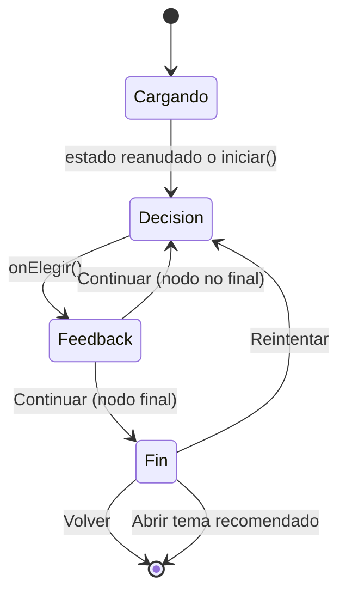
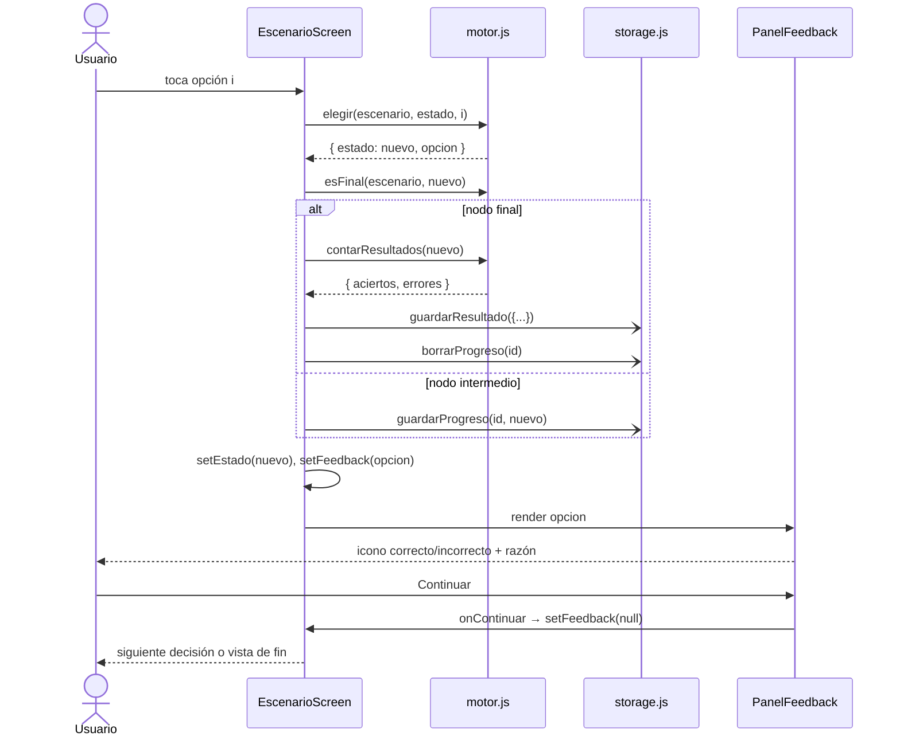

# 05 · Pantallas de escenarios

Pantallas que conectan el [motor](03-motor-escenarios.md) con el usuario y con el [almacenamiento](04-almacenamiento.md).

| Archivo | Rol |
|---|---|
| [EscenariosScreen.js](../../app/src/screens/EscenariosScreen.js) | Lista de escenarios con badge "En progreso" |
| [EscenarioScreen.js](../../app/src/screens/EscenarioScreen.js) | Juega un escenario: decisión → feedback → fin |
| [PanelFeedback.js](../../app/src/components/PanelFeedback.js) | Tarjeta de retroalimentación (HU03) |
| [Fila.js](../../app/src/components/Fila.js), [Grupo.js](../../app/src/components/Grupo.js) | Filas agrupadas estilo iOS: la lista de escenarios y las opciones de cada decisión |
| [BotonGrande.js](../../app/src/components/BotonGrande.js) | Botones de acción con icono (Continuar, Reintentar, Volver) |

Rutas en [App.js:37-38](../../app/App.js#L37-L38). El header de `Escenario` toma `route.params.titulo`, igual que `Tema` (ver [02-modulo-teorico.md](02-modulo-teorico.md#por-qué-se-pasa-titulo-en-los-parámetros)).

---

## 1. `EscenariosScreen`

- [L14](../../app/src/screens/EscenariosScreen.js#L14): `enProgreso` es un mapa `{ [escenarioId]: boolean }`.
- [L16-L22](../../app/src/screens/EscenariosScreen.js#L16-L22): carga en paralelo (`Promise.all`) el progreso de cada escenario con `cargarProgreso` y marca `true` los que tienen algo guardado.
- [L11](../../app/src/screens/EscenariosScreen.js#L11): `categorias` indexa `teoria.json` por id **una sola vez, fuera del componente**, para tomar el icono y el color de la categoría de cada escenario sin buscar en cada render.
- [L26-L38](../../app/src/screens/EscenariosScreen.js#L26-L38): un `Grupo` "Disponibles" con una `Fila` por escenario (icono y color de su categoría, descripción como subtítulo); [L34](../../app/src/screens/EscenariosScreen.js#L34) pasa la etiqueta naranja "En progreso" si hay progreso guardado.
- [L35](../../app/src/screens/EscenariosScreen.js#L35): `navigate('Escenario', { escenarioId, titulo })`.

### Por qué `useFocusEffect` y no `useEffect`

En un stack nativo, al entrar a `Escenario` la lista **no se desmonta**: queda debajo. Al volver con "atrás", un `useEffect(..., [])` no se ejecutaría otra vez y el badge mostraría datos viejos (p. ej. seguiría diciendo "En progreso" de un escenario recién terminado). `useFocusEffect` corre **cada vez que la pantalla gana foco**, así el badge siempre refleja AsyncStorage.

El `useCallback(..., [])` es obligatorio con `useFocusEffect`: sin él la función cambia en cada render y el efecto se re-ejecutaría en bucle.

---

## 2. `EscenarioScreen`

### Estado

| Variable | Línea | Contenido |
|---|---|---|
| `escenario` | [L13](../../app/src/screens/EscenarioScreen.js#L13) | Objeto del JSON buscado por `route.params.escenarioId` (no es estado de React: es una referencia fija al JSON importado) |
| `estado` | [L14](../../app/src/screens/EscenarioScreen.js#L14) | Estado del motor `{ escenarioId, nodoId, decisiones }`. `null` mientras se carga. |
| `feedback` | [L15](../../app/src/screens/EscenarioScreen.js#L15) | La `opcion` recién elegida, o `null`. Si no es `null`, se muestra el panel de feedback. |
| `nodo` | [L25](../../app/src/screens/EscenarioScreen.js#L25) | Derivado: `nodoActual(escenario, estado)` |
| `terminado` | [L26](../../app/src/screens/EscenarioScreen.js#L26) | Derivado: `!feedback && esFinal(...)`. El `!feedback` asegura que el feedback de la **última** decisión se vea antes del fin. |

`nodo` y `terminado` se calculan en cada render en vez de guardarse en `useState`: así no pueden desincronizarse de `estado`.

### Reanudar al montar (HU04)

[L17-L21](../../app/src/screens/EscenarioScreen.js#L17-L21):

```js
cargarProgreso(escenario.id).then((guardado) =>
  setEstado(guardado && escenario.nodos[guardado.nodoId] && !esFinal(escenario, guardado) ? guardado : iniciar(escenario))
);
```

Se reanuda solo si las tres condiciones se cumplen; si no, se empieza de cero:

| Guarda | Protege contra |
|---|---|
| `guardado` | No hay progreso (primera vez o ya terminado) |
| `escenario.nodos[guardado.nodoId]` | Se editó el JSON y el nodo guardado ya no existe → sin esto, `nodo` sería `undefined` y la pantalla fallaría |
| `!esFinal(...)` | Un progreso que quedó en un nodo final (no debería pasar porque se borra al terminar, pero si falló el borrado no se reanuda un escenario ya acabado) |

Mientras `estado` es `null` se muestra un `ActivityIndicator` ([L23](../../app/src/screens/EscenarioScreen.js#L23)). La dependencia `[escenario]` no re-dispara el efecto: el objeto viene del JSON importado y su referencia no cambia.

### `onElegir(indice)` — [L28-L39](../../app/src/screens/EscenarioScreen.js#L28-L39)

Orden: **motor → persistir → mostrar feedback**.

1. [L29](../../app/src/screens/EscenarioScreen.js#L29): `elegir()` calcula el nuevo estado y la opción.
2. Persistencia según a dónde se llegó:
   - Nodo final ([L30-L33](../../app/src/screens/EscenarioScreen.js#L30-L33)): `guardarResultado({ escenarioId, categoriaId, aciertos, errores, fecha })` en el historial y `borrarProgreso` (ya no hay nada que reanudar; el badge desaparece).
   - Nodo intermedio ([L34-L35](../../app/src/screens/EscenarioScreen.js#L34-L35)): `guardarProgreso` con el nuevo estado.
3. [L37-L38](../../app/src/screens/EscenarioScreen.js#L37-L38): `setEstado` y `setFeedback` → re-render con la vista de feedback.

Las llamadas a storage **no se esperan** (`await`): la UI responde al instante y `storage.js` traga los errores, así que un fallo de escritura nunca bloquea la práctica (detalles en [04-almacenamiento.md](04-almacenamiento.md)).

Se persiste **antes** de que el usuario lea el feedback: si cierra la app en ese momento, al volver reanuda en el nodo siguiente (la decisión ya cuenta).

### Las tres vistas

El componente devuelve una de tres vistas según `feedback` y `terminado`:

| Vista | Condición | Líneas | Contenido |
|---|---|---|---|
| Feedback | `feedback !== null` | [L46-L52](../../app/src/screens/EscenarioScreen.js#L46-L52) | `PanelFeedback`; "Continuar" hace `setFeedback(null)` |
| Fin | `terminado` | [L54-L64](../../app/src/screens/EscenarioScreen.js#L54-L64) | [`ResumenEscenario`](08-resumen-desempeno.md#3-resumenescenario--vista-de-fin-hu06): desenlace, aciertos/errores/%, cada decisión tomada, temas recomendados y botones Reintentar y Volver |
| Decisión | resto | [L66-L78](../../app/src/screens/EscenarioScreen.js#L66-L78) | "Decisión N" (`decisiones.length + 1`), `situacion` en tarjeta, y un `Grupo` "¿Qué haces?" con una `Fila` por opción. La `key` incluye `estado.nodoId` ([L74](../../app/src/screens/EscenarioScreen.js#L74)) para que React no reutilice el estado "presionado" de una fila del nodo anterior. |



### Reintentar / Volver

- **Reintentar** ([L41-L44](../../app/src/screens/EscenarioScreen.js#L41-L44)): limpia `feedback` y crea un estado nuevo con `iniciar`. No toca storage: el progreso ya se borró al terminar y se volverá a guardar con la primera decisión.
- **Volver** ([L60](../../app/src/screens/EscenarioScreen.js#L60)): `navigation.goBack()` → `EscenariosScreen` gana foco y recarga los badges.

### Limitación conocida

Si `escenarioId` no existe en el JSON, `escenario` es `undefined` y [L18](../../app/src/screens/EscenarioScreen.js#L18) falla. Hoy no ocurre porque la navegación solo sale de la lista del mismo JSON. No tiene el fallback que sí tiene `TemaScreen`.

---

## 3. `PanelFeedback` (HU03)

[PanelFeedback.js](../../app/src/components/PanelFeedback.js)

| Prop | Tipo | Uso |
|---|---|---|
| `opcion` | objeto opción del JSON | Lee `correcta`, `texto`, `feedback` |
| `onContinuar` | función | Botón "Continuar" |

- [L7](../../app/src/components/PanelFeedback.js#L7): color según resultado: `colores.correcto` (`#34C759`, systemGreen) o `colores.incorrecto` (`#FF3B30`, systemRed), de [theme.js:12-13](../../app/src/theme.js#L12-L13).
- [L11-L12](../../app/src/components/PanelFeedback.js#L11-L12): icono de 64 px `checkmark-circle` o `close-circle` y la palabra "Correcto"/"Incorrecto" en ese color. Se usa **icono + palabra + color**: el resultado se entiende aunque el usuario no distinga rojo de verde (accesibilidad, RNF09).
- [L13-L14](../../app/src/components/PanelFeedback.js#L13-L14): "Tu elección" y el texto de la opción elegida.
- [L16](../../app/src/components/PanelFeedback.js#L16): el `feedback` (la razón), tras un separador.
- [L18](../../app/src/components/PanelFeedback.js#L18): botón "Continuar" (icono `arrow-forward`) **fuera** de la tarjeta. El usuario debe tocarlo: el feedback no se salta solo, cumpliendo "antes de continuar al siguiente paso".

---

## 4. Secuencia de una decisión



(`-)` = llamada asíncrona sin esperar.)

---

## 5. Resumen y desempeño

La vista de fin y la pantalla "Mi desempeño" se documentan en [08-resumen-desempeno.md](08-resumen-desempeno.md).
